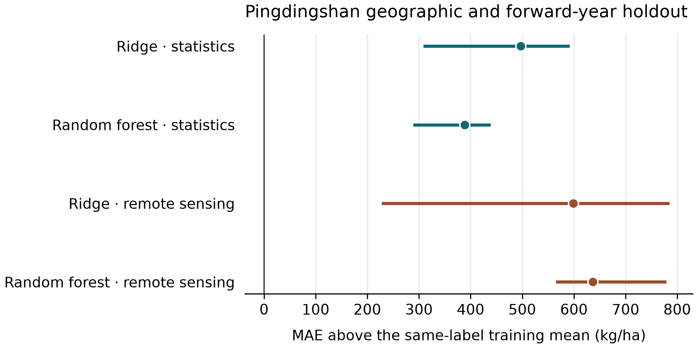

# Weather-based winter wheat yield prediction under geographic transfer in North China

W51 research manuscript draft, 2026-11-24

## Abstract

County-scale winter wheat prediction often draws training yields from official statistics or satellite products. The choice may affect apparent skill when models must transfer to a new region and a later harvest year. We compared a training-mean predictor, ridge regression and a random forest in a retrospective design using six weather features derived from data through 30 April. Each model was trained separately on statistical and satellite-derived yields using the same county-years, then scored against the same held-out statistical yields. A Shijiazhuang–Tai’an development dataset contained 79 eligible county-years from 2017–2021. Ridge regression had the lowest mean absolute error (MAE) in forward-year validation, whereas the training mean led under joint geographic and temporal holdout. In a separate Pingdingshan pilot, the training mean again led under both training labels and across three test coverage rules. On the six primary test county-years, ridge and random forest increased MAE by 389–636 kg/ha over the corresponding training means. The direction of the label-source difference varied by model and test setting. These pilots motivate paired evaluation against statistical yields and explicit baseline checks before regional deployment.

## Introduction

Early-season forecasts are useful only to the extent that they retain skill outside the seasons and locations used to develop them. A county-level prediction also depends on how yield is defined. Administrative statistics summarize recorded production and sown area, whereas satellite-derived yield estimates inherit the spatial coverage and inputs of the retrieval model. Models may learn different relationships even when both training labels are intended to describe the same crop.

Recent research has used simulated yields to train winter wheat models and assessed them at county and station scales. Public crop-yield benchmarks also provide comparison baselines and explicit forecast timing. The present analysis asks whether swapping the training label changes test error and model ordering when counties, feature windows, estimators and evaluation targets are shared. We examine transfer from two development areas to a third, with earlier harvest years providing training data for each test year. [Process-model training labels](https://doi.org/10.1002/jsfa.70947) · [CY-Bench](https://doi.org/10.5194/essd-18-3997-2026)

## Materials and methods

**Yield and geography.** County statistical yield was calculated as official wheat production divided by sown area. Satellite-derived county yield was the area-weighted mean of valid, positive ChinaWheatYield30m pixels within a fixed 2017 county boundary snapshot. For the primary analysis, the ratio of positive satellite pixel area to reported sown area had to fall between 2/3 and 1.50. The strict interval was 0.80–1.25. An additional comparison retained all paired records with positive satellite coverage. Shijiazhuang reports winter wheat explicitly. Tai’an reports summer-harvest wheat and has local evidence of autumn-sown wheat. The same seasonal interpretation was supported agronomically for Pingdingshan, whose tables use the wheat label. [Satellite product](https://doi.org/10.5194/essd-15-4047-2023) · [Source and crop audit](../ManageFiles/W47_平顶山原表与季型核查.md)

**Predictors and estimators.** For each county, NASA POWER daily weather from the county bounding-box centre was summarised from October to the end of April. The six features were October–November and March–April growing degree days above 0 °C, December–February days below −5 °C and cumulative precipitation, March–April cumulative precipitation, and April days with a maximum temperature of at least 25 °C. The three estimators were the training-label mean, ridge regression with within-fold standardisation and regularisation parameter 1, and a 200-tree random forest with a minimum of two training rows per terminal leaf and random seed 42. [Weather protocol](../Outputs/reports/w44_frozen_design.md) · [NASA POWER daily service](https://power.larc.nasa.gov/docs/services/api/temporal/daily/)

**Evaluation.** The development analysis isolated later years, whole regions, and both together. For the separate Pingdingshan test, each harvest year from 2019 to 2021 used only earlier Shijiazhuang and Tai’an county-years. Both training-label arms shared county-year membership, and official statistics were the common test target. Training membership stayed fixed when changing the external coverage rule. We assessed MAE, root mean squared error and signed bias. At the external site, the paired MAE difference compares the absolute errors on the same county-years. Deletion ranges recompute that difference after dropping one year, county or weather sequence at a time, using the original predictions. [Development analysis](../Outputs/reports/w45_label_swap.md) · [Frozen external design](../Outputs/reports/w48_pds_frozen_design.md)

## Results

**Joint holdout reduced the advantage of weather-based models.** In forward-year validation within the development areas, ridge regression had the lowest pooled MAE for both labels, 426.9 kg/ha for statistical training and 543.8 kg/ha for satellite training over 45 test county-years. Under the joint area and later-year holdout, the corresponding training means led at 470.4 and 544.4 kg/ha over 45 test county-years. The mean also led when each region was held out across all years. [Development scores](../Outputs/reports/w45_primary_metrics.csv)

**The mean baseline led in the separate Pingdingshan pilot.** Nine county-years had complete weather and positive satellite coverage, and six passed the primary coverage screen. The primary set contained four records in 2019 and one record in each of 2020 and 2021. Mean predictors gave MAEs of 1022.2 kg/ha with statistical training and 891.7 kg/ha with satellite training. For the statistical and satellite training arms, respectively, the MAEs were 1519.2 and 1490.6 kg/ha for ridge regression and 1410.8 and 1528.1 kg/ha for random forest. All four model-to-baseline differences stayed positive under single-group deletions (Fig. 1). [External scores](../Outputs/reports/w49_pds_primary_metrics.csv) · [Paired differences](../Outputs/reports/w50_pds_paired_differences.csv)

**Figure 1.** Points show the additional MAE relative to the training mean with the same label source. Lines span the observed minimum and maximum after individually omitting a harvest year, county, or weather sequence. The primary comparison uses six county-years from one external region, with three distinct weather sequences. [Source data](../Outputs/reports/w50_pds_paired_differences.csv)

**A third-region test flipped the picture toward transferable skill.** On 19 county-years from Zhoukou (eastern Henan, the winter-wheat core belt), models trained on the frozen Hebei-Shandong panel transferred: statistical-label ridge reached MAE 380.2 kg/ha, well below the training-mean baseline (920.4); random forest with satellite training reached 435.8. All predictors showed systematic negative bias (Zhoukou yields sit above the training distribution), consistent with a core-belt region producing above-distribution yields. The pilot thus splits the earlier pilots into two regimes: where the test region sits inside the training distribution (Pingdingshan-like), a training mean is the honest default; where it sits outside (Zhoukou-like), fitted models can transfer meaningful skill - and the label-source difference remains model-dependent. [Zhoukou external scores](../Outputs/reports/w53_zhoukou_external_scores.csv) · [Frozen design](../Outputs/reports/w53_zhoukou_frozen_external.csv) · [Weather fingerprints](../Outputs/intermediate/w53_zhoukou_fingerprints.csv)

**Training-label differences depended on the comparison.** The satellite-trained mean had lower error in Pingdingshan, while the statistical mean had lower error in the development joint holdout. In Pingdingshan, the ridge MAE difference (satellite minus statistical training) changed sign over group deletions, ranging from −260.8 to +87.6 kg/ha. Five of the six primary county-years had at least one weather feature outside the training range. The largest errors occurred in the single record with all six features inside the corresponding ranges (Lushan, 2019). [External predictions](../Outputs/reports/w49_pds_oof.csv) · [Sensitivity results](../Outputs/reports/w50_pds_diagnostics.md)

## Discussion

In these pilots, a training-label mean was a harder baseline to beat when both the place and the harvest year changed. Its advantage persisted when the Pingdingshan coverage rule changed and after omitting individual groups. The label-source comparison had no uniform direction across models and validation settings. This matters when satellite labels are attractive for their wider spatial availability. A paired experiment on a common evaluation target reveals whether a reported change in performance persists when differences in sample composition are controlled.

The external evidence covers one additional prefecture, with most eligible records in 2019 and one repeatedly represented county in the later two years. The coarse weather series do not resolve within-county crop exposure, and administrative statistics and satellite products can describe different spatial supports. The satellite product uses temperature and precipitation from some of the same months as our weather predictors. Its published methods describe comparisons with provincial and municipal statistics, and its limitations also refer to calibration with statistical data. The public release lacks a matching county-year calibration ledger, leaving upstream overlap with the held-out targets unresolved. Separate site-level yield observations were unavailable for this analysis. A larger external panel with more independent regions and harvest years, and a traceable source of independent yield observations, would help separate the effects of target construction, data coverage and environmental differences. [Source audit](../Outputs/reports/w52_label_provenance.md)

## Conclusion

Fixed-model label swaps with joint geographic and temporal holdout reveal whether weather-based models add skill over a training mean. With the present weather representation, the mean led under joint holdout in the development and external pilots. The label-source effect varied and warrants evaluation on a common held-out target wherever predictions will be used.

## Data and code availability

The repository contains yearbook and bulletin source references, paired county-years, frozen cohorts and folds, all test predictions, and scripts. Source rasters and daily weather come from Zenodo and NASA POWER and are checked against recorded checksums. A single command regenerates the figures and scores from the checked-in frozen tables. [Reproduction instructions](../README.md#当前研究复现) · [Claim-to-evidence table](../ManageFiles/研究主张与证据.md)
